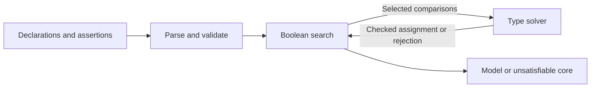

# Mini Type Solver Design

## The problem

This project explores how Boolean search and type inference work together. An
input describes a type environment and a formula of subtype comparisons. The
solver tries to find one assignment of types to unknowns that makes the formula
hold. The experiment compares three ways to search the Boolean formula while
keeping the type rules and type solver the same.

Consider two unknown types connected by a subtype relation:

```text
class Animal;
class Dog extends Animal;
metavar ?T;
metavar ?U;

assert Dog <: ?T;
assert ?T <: ?U;
assert ?U <: Animal;
```

The comparisons constrain the unknowns together: `T` must include `Dog`, `U`
must include `T`, and both must fit within `Animal`. The solver returns its
checked joint assignment:

```text
satisfiable
model:
  ?T = Dog
  ?U = Dog
```

Boolean alternatives add another question: which comparisons should hold
together? Choosing a branch can change the required types or expose a
contradiction. This leads to the central separation in the design:



The Boolean engine chooses comparisons. The type solver checks those
comparisons as one problem. A successful type check supplies the model; a
failure lets Boolean search try another choice. Even within a selected Boolean
branch, the type solver may need to choose union arms or generic instances. The
engines share that second layer of search as well as the type rules.

## Scope

The type language combines named classes, generic class instances, unions,
intersections, fixed-length tuples, positional callables, and generic callables.
Metavariables can receive any of these types, including recursive types formed
by their constraints. Generic callable parameters can have upper bounds or
finite exact sets, which the frontend translates into the ordinary type
language.

The project is an experimental constraint solver. It does not model Python
syntax, class members, structural protocols, or overload resolution. Callables
have fixed arity and no named, optional, keyword, or variadic parameters.
Metavariables and generic parameters cannot be applied as type constructors.
Generic callables have no explicit type arguments or lower parameter bounds.
Recursive types have output notation but no explicit input notation, and
formulas contain no negation.

A successful result is one valid witness, with no promise that it is least,
greatest, or preferred across branches. An `unsatisfiable` result means that the
specified type search exhausted its permitted alternatives. The search is not
claimed to be complete over every possible type model, and some valid inputs
can make it run indefinitely. There is no default work or time limit. These
limits matter when interpreting engine comparisons: the engines share one
search contract, including its limits.

## From an input formula to selected comparisons

The frontend resolves forward references, checks the class environment and
lexical bindings, and rewrites types before search starts. Source normalization
uses local identities such as `T | never = T`, flattens repeated operators, and
removes duplicates. It does not use inheritance to remove subtype-related terms
or distribute intersections over unions. Equal normalized endpoint pairs denote
one comparison even when they occur at several source locations.

All search requests use that same validated environment. Choosing fewer
assertions does not remove declarations, alter class relationships, or change
parameter bindings. This fixed environment is essential to both pruning and
core reduction.

An atom is one `<:` comparison. The Boolean engine treats atoms as indivisible
choices; the type solver handles their contents. `and` requires every child and
`or` requires at least one. Because there is no negation, an unselected atom adds
no type requirement. It does not assert that the subtype relation is false.

For example, using the classes from the opening example:

```text
assert (Animal <: ?T) or (Dog <: ?T);
assert ?T <: Dog;
```

Choosing `Animal <: ?T` produces an impossible pair with `?T <: Dog`. Choosing
`Dog <: ?T` produces a valid assignment. The three engines reach this choice
in different ways:

| Engine | How it chooses comparisons | Main cost |
| --- | --- | --- |
| `dnf` | Expand into disjunctive normal form (a disjunction of conjunctions), then check each conjunction. | All conjunctions are materialized before checking starts. |
| `direct` | Traverse the formula, extending the selected set and backing up when the type solver rejects it. | Search can revisit many branches, but it can reject a partial choice early. |
| `varisat` | Encode the formula as SAT clauses and ask varisat for a Boolean assignment. Check the atoms marked true and block rejected selections. | The encoding stays linear in formula size, but many SAT and type checks may be needed. |

SAT is Boolean satisfiability: finding truth values that satisfy a propositional
formula. Its Boolean assignment chooses the atoms to submit to type checking.
DNF and direct search use source order, with the first child varying slowest
when choices combine. The SAT engine uses an incremental SAT solver and a
one-way helper encoding, which is sufficient because the formula is positive.
If a set of selected atoms fails the type check, a blocking clause excludes
that set and every superset.

All three engines share the same verdict contract. They may return different
witnesses or subset-minimal cores because they can select different branches.
All have exponential worst-case search: avoiding DNF materialization reduces one
source of cost without making the underlying problem cheap. Whichever route an
engine takes, it submits subtype comparisons to the same type solver. The type
rules determine which sets that solver can accept.

## The type system

### Subtyping and overlap answer different questions

`A <: B` means that `A` is below `B` in the type relation. The environment has
`never` at the bottom and `object` at the top, so `never <: T <: object` for
every type `T`. Named classes get their subtype relations from declarations.

Unions and intersections form a distributive algebra. `A | B` includes both
alternatives; `A & B` requires both factors. As a result, a lower union must
satisfy every comparison, and an upper intersection requires every factor:

```text
A | B <: U    iff    A <: U and B <: U
L <: A & B    iff    L <: A and L <: B
(A | B) & C   =      (A & C) | (B & C)
```

An upper union and a lower intersection leave room for choices. For example,
different arms of a lower union can satisfy different arms of the upper union.
There need not be one upper arm that covers the whole lower type.

A missing subtype relation does not establish disjointness. The class world is
open: an undeclared common subclass can make two unrelated classes overlap.
Consequently, `Dog & Cat` can remain non-bottom, and the solver does not replace
an intersection with the common descendants listed in the input. This also
applies to generic class instances with incompatible invariant arguments. The
model allows overlap without assigning every value one fixed ancestor instance.

Constructor shape provides stronger information. A class other than `object`
is disjoint from a tuple or callable; tuples of different lengths and callables
of different arities are disjoint. Bound generic parameters have unknown shape,
so they do not establish these conflicts.

### Constructors preserve structure; variance controls comparison

A constructor keeps its arguments in their declared positions. Subtyping
compares those positions according to variance:

| Type form | Rule |
| --- | --- |
| `tuple[L1, L2] <: tuple[U1, U2]` | Compare each `Li <: Ui`; lengths must match. |
| `(L1) -> L2 <: (U1) -> U2` | Require `U1 <: L1` and `L2 <: U2`; arities must match. |
| `C[L] <: C[U]` for `class C[+T]` | Require `L <: U`. |
| `C[L] <: C[U]` for `class C[-T]` | Require `U <: L`. |
| `C[L] <: C[U]` for `class C[T]` | Require both directions with the same enclosing unknowns. |

Callable parameters reverse the relation because a replacement function must
accept everything the original function accepts. Returns preserve the relation
because the replacement's result must fit the expected result. Thus
`(Animal) -> Dog <: (Dog) -> Animal` when `Dog <: Animal`.

Constructors do not distribute over unions or intersections. For example,
`tuple[A] | tuple[B] <: tuple[A | B]`, but the reverse need not hold. An
intersection of tuple types keeps its separate tuple factors rather than merging
their elements. The same principle applies to classes and callables. In this
type algebra, `tuple[never]` and `Inv[never]` retain their constructor shape and
are distinct from `never`.

Class inheritance adds substitution to these structural comparisons. For
example, if `class Child[T] extends Parent[tuple[T]];` and `Parent` is
covariant, then `Child[Dog]` has ancestor `Parent[tuple[Dog]]`, which is below
`Parent[tuple[Animal]]`. The ancestor relation comes from the declarations;
matching arguments alone cannot create it.

Multiple inheritance uses C3 linearization to give each class a consistent
ancestor order that respects its declared superclass order. User classes have
`object` as an implicit final base unless it is already listed. When different
paths reach the same generic ancestor, they must supply structurally equal
normalized arguments at every position, regardless of variance. This keeps the
declared hierarchy consistent before any assertions are solved. Variance
declarations are checked against their uses in direct superclass arguments.

The direct superclass graph must be acyclic, but a superclass argument can
refer to the declaring class. `class Int extends Comparable[Int];` is a valid
example. Such a nested reference stays a finite argument expression; it does
not recursively expand the class's ancestors during validation.

### Generic callables introduce local quantifiers

A generic callable describes a family of callable bodies. Its parameters are
local to the binder, while a declared metavariable is one unknown shared across
the selected comparisons. That difference determines how generic subtyping
works.

For a generic callable on the lower side, the solver can choose an instance
that satisfies the requirement:

```text
forall X. (X) -> X <: (Dog) -> Animal
```

Choosing `X = Dog` makes the comparison hold. Every occurrence of `X` in that
body uses the same selection. Separate requirements can choose separate
instances, so the generic identity can satisfy both `(Dog) -> Dog` and
`(Cat) -> Cat`.

For a generic callable on the upper side, the requirement must hold for an
arbitrary parameter value:

```text
(object) -> never <: forall X. (X) -> X
```

The lower callable accepts every possible argument and returns a subtype of
every possible result. In contrast, `(Dog) -> Dog` cannot meet that generic
requirement for arbitrary `X`.

When both sides are generic, the upper parameters are introduced first. The
lower selections may depend on those arbitrary parameters. This explains why
`forall X. (X) -> X <: forall Y. (Y) -> object` holds. Nesting still matters: a
selection cannot depend on a parameter introduced only after the comparison
enters a later, nested binder.

Selections are restricted to **generic-free types**: types whose rewritten form
contains no `forall`. They may include classes, tuples, monomorphic callables,
unions, intersections, and recursive references. A metavariable can store a
generic callable, but a generic parameter cannot select it as a generic value.
This restriction keeps parameter selection within the stated type language.

### Parameter restrictions reduce to ordinary type expressions

Upper bounds and exact sets are source syntax. Writing `F(X)` for a callable
body that uses `X`, their meaning is defined by these rewrites:

```text
forall X <: A. F(X)       = forall X. F(X & A)
forall X in {A, B}. F(X)  = F(A) & F(B)
```

The first rewrite represents a type below `A` by intersecting it with `A`.
The second represents the finite permitted instances as an intersection of
callables. This lets the solver use the same union, intersection, and generic
rules for restricted and unrestricted inputs. With several exact-set parameters,
each combination of members produces an instance.

Restrictions must be closed generic-free source types: they contain no
metavariable, generic parameter, or source `forall`. Rewriting can remove a
binder entirely, as in `forall X in {Dog}. (X) -> X`, which becomes
`(Dog) -> Dog`. Output uses the rewritten and normalized type; it does not
recover the restriction's original spelling.

Binder names do not determine type identity. Parameters retain their ordered
roles, and a reference belongs to its lexical binder. An inner binder can shadow
an outer name without changing references already bound to the outer binder.
This binding remains intact through substitution, normalization, and recursion.

## Solving selected comparisons

### Lower contributions and upper requirements build one joint assignment

The type solver groups comparisons connected by shared metavariables, including
occurrences inside constructor arguments. Independent groups can be solved
separately, while every occurrence of an unknown within a group uses the same
value.

For each unknown, lower comparisons contribute expressions that its value must
include. Upper comparisons constrain those expressions. In the opening example,
`Dog <: ?T` contributes `Dog`; `?T <: ?U` carries that contribution to `U`; and
`?U <: Animal` checks that it fits. The solver checks these requirements before
closing the accumulated lower expressions into values. Multiple contributions
form a union, and an active variable with no contribution gets `never`.

Constructor comparisons can introduce new requirements in either direction.
For example, `(?P) -> Dog <: ?F` together with `?F <: (Dog) -> Animal`
requires `Dog <: ?P` through parameter contravariance. The assignment is
therefore constructed jointly: solving one unknown can change the requirements
on another.

Whenever a new lower contribution or upper requirement arrives, their composed
comparison must be checked. The solver retains each requirement even if later
information would simplify the eventual value. Otherwise, a
contradiction could disappear merely because another constraint was added.

### Structural choices are part of type search

Union and intersection rules can introduce alternatives inside one selected
Boolean branch. A lower union requires every arm to pass; an upper intersection
requires every factor. The solver expands bare lower variables through their
contributions, then tries compatible upper union arms and lower intersection
factors. Each lower arm can make its own choice.

Class variance, tuple covariance, and callable variance turn constructor
comparisons into child comparisons. Fixed shape conflicts can establish bottom
before further search, while unrelated classes and unknown generic parameters
cannot. Constructor contents remain in their positions throughout this process.

A failed alternative restores the requirements, selections, and scopes created
under it before the next alternative is tried. Rejection occurs only after all
permitted alternatives fail. Comparisons that hold for every assignment by their
written form, such as `?T <: ?T`, need no further propagation.

### Generic instances must stay within their scopes

Generic comparison introduces arbitrary upper parameters and selected lower
parameters. Those parameters are visible only in the scopes that justify them.
A declared unknown cannot acquire a free reference to a local arbitrary type.
When a type moves out of such a scope, conversion widens covariant positions and
narrows contravariant positions to preserve the required relation. A hidden
arbitrary parameter becomes `object` when widening and `never` when narrowing.
Class variance and callable variance determine the direction at each child.

Some parameter selections encounter a generic callable before all of its uses
are known. The solver delays instantiation at that position and creates a
separate generic-free instance for each later requirement. The final value is
the intersection of those instances, or `object` if no instance is required.
Each requirement must be checked against its own instance, including any scope
conversion it needs.

The delayed position has unknown shape during search. A temporary collection of
instances cannot establish disjointness or erase another required comparison.
This preserves the distinction between satisfying a requirement and simplifying
a value after that requirement has been checked.

### Recursive equations require guarded structure

Lower contributions can refer back to their unknowns. A bare cycle such as
`?T <: ?U; ?U <: ?T` does not force an infinite type: with no other contribution,
both values can be `never`. More generally, self-contributions through unions
and intersections can be eliminated algebraically. For example,
`X = (X & P) | Q` admits `X = Q` because `Q & P <: Q`.

A reference inside a constructor carries structure that the elimination must
preserve. The lower comparison `tuple[?T] <: ?T` gives a guarded recursive
equation whose value prints as:

```text
mu R0. tuple[R0]
```

`R0` refers to the whole type defined after the dot. An upper comparison alone,
`?T <: tuple[?T]`, does not create this equation; its checked value is `never`.

Recursive values do not make every circular subtype argument valid. After
collapsing loops caused only by expanding lower expressions, a comparison cycle
must cross matching constructor contents and must contain no superclass step.
A superclass step before the cycle is permitted. This ensures that returning to
a comparison relies on guarded type structure rather than circular inheritance
reasoning. The solver does not assume unrestricted transitivity for recursive
comparisons.

## Why the result can be trusted

### Rejection must survive the addition of constraints

Both direct pruning and SAT blocking rely on one property: if a selected set is
rejected, every superset from the same input is also rejected. Core reduction
uses the same property when it removes requirements.

The type search preserves this property by keeping each comparison's permitted
choices and required checks fixed. Adding constraints can add contributions and
demands, but it cannot erase an earlier check or change the alternatives that
were available to satisfy it. Generic selections and scope conversions retain
their originating requirements. Delayed generic instances are checked per demand
and cannot be used to dismiss a conflict during search.

To see the reasoning, suppose a larger selected set succeeds. Keeping the
choices and checks required by a smaller set gives an accepted branch for that
smaller set: removing requirements leaves fewer obligations, with the same
permitted selections and scope relations. The recursive cycle rules are
preserved as well. Therefore an exhausted failure for the smaller set rules out
success for the larger one. This argument concerns the specified search and its
returned results; it assumes neither termination nor completeness over all type
models.

For the positive Boolean formula, a valid type assignment may make additional
atoms true beyond those selected by the engine. That cannot invalidate an `and`
or `or` formula. This is why a checked selection supplies a witness for the
original formula and why SAT needs no negative type constraints.

### Acceptance checks the choices that produced the witness

Finishing propagation does not by itself accept a model. The solver builds the
complete joint assignment and validates the selected comparisons and their
required child comparisons. Validation uses the recorded generic selections,
instances, scope conversions, and recursive comparison structure that justified
the branch. It does not make a new parameter selection to rescue the result.
A failed validation is a programming error.

Normalization then prepares the checked values for output. Structural
normalization flattens unions and intersections, distributes intersections over
unions, applies top and bottom identities, and removes duplicate or disjoint
parts. It works recursively within constructor arguments while preserving each
constructor. It also removes unused generic parameters without changing the
bindings of the parameters that remain.

Finite values with acyclic class-reference dependencies can additionally use
subtype proofs to remove covered terms. For example, `Dog | Animal` becomes
`Animal`. Each removal retains a proof, and validation checks the substituted
comparisons with the normalized values. A stored generic is simplified only
when a read-only comparison can justify the removal; normalization does not
perform fresh generic selection.

If any component contains a recursive value or a reachable class-reference
cycle, the whole assignment uses structural normalization only. This includes
finite parts of that assignment. Restricting subtype removal keeps normalization
within the proof rules available for those comparisons, where unrestricted
transitivity cannot be assumed. Once validation is complete, public values keep
their immutable types and parameter bindings while search records are released.

## Results and reproducibility

### A model is one checked witness

A satisfiable result has the `satisfiable` and `model:` headers followed by one
entry per declared metavariable, in declaration order. Assigned entries contain
complete types: no free metavariable, internal selection, arbitrary parameter,
scope copy, or delayed instance appears in the output. Parameters bound by
`forall` and recursive references bound by `mu` are part of a complete type.

A declaration is `unconstrained` when it occurs in no endpoint of the selected
comparisons after frontend normalization and restriction rewriting. This covers
unused declarations, unselected branches, and mentions removed by rewriting.
Such an entry can be extended with any complete type without affecting the
selected comparisons. By comparison, a selected `?T <: object` has a checked
assignment of `never`; it is an active requirement. An input with no assertions
prints `unconstrained` for every declared metavariable.

Output uses the solver's existing joint assignment and introduces no additional
choices about which endpoint or instance to prefer. Remaining generic parameters
keep declaration order and print as `T0`, `T1`, and so on; recursive definitions
use `R0`, `R1`, and so on.
Names avoid declared classes, metavariables, and enclosing binders. A recursive
child gets another `mu` name when its own loop requires one.

A printed value can be exponentially larger than its input. The output format
has no syntax for shared subterms, so each occurrence prints in full. In a chain
of comparisons `tuple[?Ti, ?Ti] <: ?Ti+1`, each step doubles the expanded type
of the preceding variable. Finite sharing does not introduce a `mu` definition.

### A core explains an exhausted failure

An unsatisfiable result prints `unsatisfiable` and a `core:` list of source
units. Assertion labels identify named units; source positions identify unnamed
ones. Before solving, the frontend splits the outermost conjunction of each
assertion into units. A conjunction below a disjunction stays within its unit,
because separating it would change the choice being explained.

Core reduction removes units in source order and reruns the selected engine.
A unit is removed when the remaining formula is still rejected. The resulting
core is subset-minimal under the shared search contract: the complete core is
unsatisfiable, and removing any one remaining unit makes it satisfiable. This
need not be a core with the smallest number of units, and another engine can
find a different subset-minimal core. Each check keeps the original validated
environment. Reduction can require another complete solve for each source unit.

### Repeatable output and measurable search costs

For a fixed implementation and dependency set, each engine returns repeatable
verdicts, models or cores, and non-time counters. Diagnostics and core reduction
use source order, as do alternatives in the DNF and direct engines. Type
alternatives use a stable structural order; class and declared-metavariable
order comes from their declarations.
Tuple and callable positions retain their order. This controls which witness is
reported without assigning it an optimality meaning.

`solve --engine <dnf|direct|varisat>` selects the Boolean engine; `direct` is
the default. Results go to stdout, while diagnostics, logs, and statistics go to
stderr. A successful solve exits with status 0 even when its verdict is
unsatisfiable. Input or file errors use status 1; command-line usage errors use
status 2. Other commands and options are described in the [README](../README.md#commands).

The `--stats` counters make the costs of the three approaches visible:

| Counters | What they measure |
| --- | --- |
| `theory_calls`, `activated_atoms_sum`, `peak_activated_atoms` | Calls to the shared type solver, total selected-set sizes, and peak selected-set size. |
| DNF `materialized_terms` | Conjunctions materialized by formula expansion. |
| Direct `branch_attempts`, `backtracks` | Disjunction children entered and failed. |
| SAT `generated_clauses`, `sat_calls`, `theory_lemmas` | Encoding clauses, SAT calls, and blocking clauses from rejected type checks. |
| `elapsed_ms` | Total selected-engine time, including core reduction. |

Counters include work during core reduction. SAT clause counts include formula
encodings and exclude the blocking clauses counted by `theory_lemmas`. Solver
identity and configuration are reported with SAT statistics. Elapsed time is not
deterministic.

## Verification

Cross-engine agreement checks the Boolean search layer, but all engines share
the same type solver. A shared type bug could therefore make all three agree on
a wrong result. Tests also use an independent evaluator that reads public model
entries against the original source declarations and formulas. It has its own
rules for inheritance, variance, generics, overlap, bindings, and recursive
comparison; it does not reuse production normalization or comparison code.

The evaluator checks complete selections when comparing generic callables. Its
finite selection pool is conservative: it can miss a valid witness, but a
successful check must establish the complete comparison. Rejection by this
evaluator does not justify a SAT clause or prove class disjointness. Tests that
alter public assignments confirm that checking is based on the reported model.

Core tests rerun the reported core and every one-unit deletion in the same
original environment. SAT tests also verify that each blocking clause rejects
the current Boolean selection and refers to a type-rejected set. Together,
these checks cover the witness contract, subset-minimality, and the connection
between type rejection and Boolean pruning.

## Input syntax reference

An input consists of declarations and assertions. Names match
`[A-Za-z_][A-Za-z0-9_]*`; metavariable names start with `?`. Whitespace and `#`
line comments separate tokens, and declarations can refer to later declarations.
The reserved words are `class`, `extends`, `metavar`, `assert`, `and`, `or`,
`tuple`, `forall`, and `in`.

```text
file             := declaration*
declaration      := class-decl | metavar-decl | assertion
class-decl       := "class" NAME class-parameters?
                    ("extends" superclass ("," superclass)*)? ";"
class-parameters := "[" class-parameter ("," class-parameter)* "]"
class-parameter  := NAME | "+" NAME | "-" NAME
superclass       := NAME class-arguments?
class-arguments  := "[" type-expr ("," type-expr)* "]"
metavar-decl     := "metavar" META_NAME ";"
assertion        := "assert" (NAME ":")? formula ";"
formula          := conjunction ("or" conjunction)*
conjunction      := formula-primary ("and" formula-primary)*
formula-primary  := subtype | "(" formula ")"
subtype          := type-expr "<:" type-expr
type-expr        := generic-callable-type | callable-type | type-union
generic-callable-type := "forall" generic-parameter
                         ("," generic-parameter)* "." callable-type
generic-parameter := NAME
                   | NAME "<:" type-expr
                   | NAME "in" "{" type-expr ("," type-expr)* "}"
callable-type    := "(" callable-params? ")" "->" type-expr
callable-params  := type-expr ("," type-expr)*
type-union       := type-intersection ("|" type-intersection)*
type-intersection := type-primary ("&" type-primary)*
type-primary     := NAME | NAME class-arguments | META_NAME
                    | tuple-type | "(" type-expr ")"
tuple-type       := "tuple" "[" (type-expr ("," type-expr)*)? "]"
META_NAME        := "?" NAME
```

Operators bind in the order `&`, `|`, `->`, `<:`, `and`, `or`, with the
leftmost binding most tightly. The arrow associates to the right. A `forall`
binder owns the complete callable body after its dot, so callable and generic
callable factors need parentheses when used inside a union or intersection.

Argument and parameter positions are ordered. Explicit class argument lists,
class parameter lists, and exact sets must be non-empty. Empty tuple and callable
parameter lists are valid. Lists have no trailing comma, and callable parameter
parentheses are required. Only a class name can take arguments, and every
application supplies the declared number of arguments; `object` and `never`
cannot take arguments.

Class parameter scope covers superclass arguments, while each superclass root
resolves as a class name. A superclass argument cannot contain a source
metavariable or `forall`. Class parameters may be unused. Generic callable
parameters must occur in their body when validation checks the binder. This
check runs after nested rewrites and ordinary normalization, before that binder's
own restrictions are rewritten. Subsequent rewriting or model normalization can
remove parameters that passed this validation. Parameter names within one binder
must be distinct and cannot be `object` or `never`.

The built-ins cannot be redeclared, `never` cannot be a superclass, and duplicate
direct superclass names are invalid. Validation also rejects duplicate
declarations or assertion labels, unresolved names, invalid applications,
inconsistent inheritance, and variance violations. It checks declaration
collection, class and assertion resolution, direct self edges, hierarchy cycles,
C3 order, repeated ancestor arguments, and variance in
that order. Earlier phases take precedence over later source locations;
independent errors within a phase follow declaration or source order.

Source input has no explicit delimiter-nesting, generic-parameter-count, or
exact-set-expansion limit. Exact-set products and nested expansions can be
exponential. Whitespace permits complete CRLF pairs but no bare carriage return.
The programmatic formula API also permits empty conjunctions and disjunctions,
whose meanings are true and false respectively; source syntax cannot express
those empty nodes.
